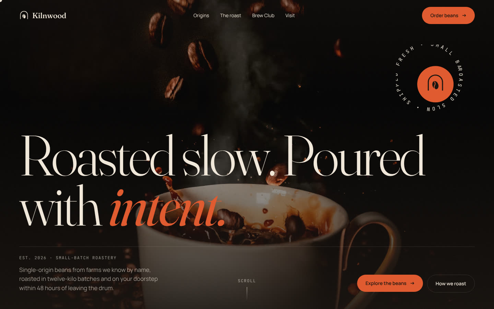
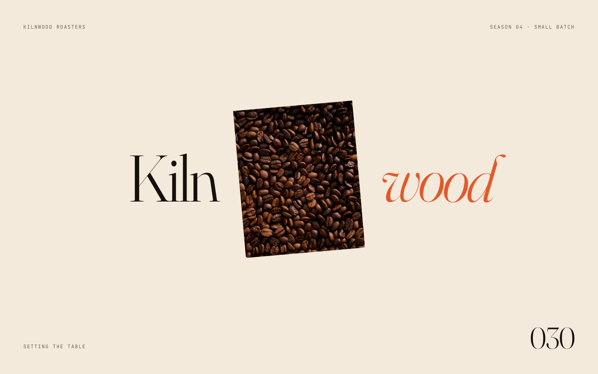
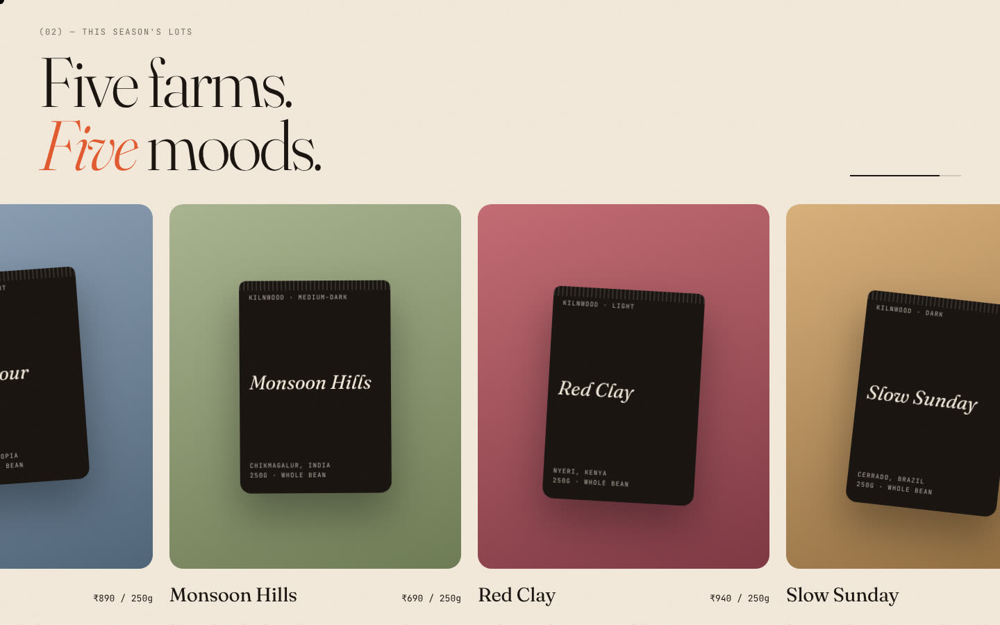

# Kilnwood Roasters

**A motion-led, editorial website for a fictional small-batch coffee roastery.** Built as a front-end design showcase: an opening sequence that introduces the brand, smooth scrolling, and scroll-driven storytelling across every section.

**Live site:** <https://kilnwood-roasters.vercel.app>



| Opening sequence | This season's lots |
| --- | --- |
|  |  |

## The opening: "The Tasting Deck"

The brand name splits around a small card while five coffee photographs are dealt onto it like prints (*Roasted, Brewed, Poured, Tasted, Yours*), with a counter running to 100. The name then slides apart and the last photo opens out to full screen, becoming the hero background with no visible seam. It waits for images and fonts, but never holds visitors more than 0.7 s after the sequence ends.

## Motion inventory

| Section | Technique |
| --- | --- |
| Intro | Split wordmark with blur-in characters, clip-path card deal, caption roll, card-to-fullscreen handoff |
| Hero | Masked per-character headline, spinning badge that speeds up with scroll velocity, photo parallax |
| Origins marquee | Infinite loop that reverses with scroll direction and accelerates with velocity |
| Manifesto | Word-by-word opacity scrubbed to scroll |
| Origins | Pinned horizontal scroll with progress bar and per-card tilt (`containerAnimation`) |
| Process | Pinned timeline, scrubbed progress line, rolling step number |
| Stats | Count-up on enter |
| Brew Club | Clip-path reveal, animated steam, price tween on plan toggle |
| Footer | Scrubbed character rise on the oversized wordmark |
| Global | Custom cursor with labels, magnetic buttons, hide-on-scroll header, film grain |

Everything respects `prefers-reduced-motion`.

## Stack

- **Next.js** (App Router, TypeScript)
- **GSAP** with ScrollTrigger and SplitText
- **Lenis** smooth scrolling, synced to the GSAP ticker
- Fraunces, Manrope and JetBrains Mono (Google Fonts)
- Deployed on **Vercel**

## Run locally

```bash
npm install
npm run dev
```

## Credits

Kilnwood, its products, prices and copy are invented. Photography from [Unsplash](https://unsplash.com) under the Unsplash License.

Built by **Hussain Singapuri** ([@huss2003](https://github.com/huss2003)).
